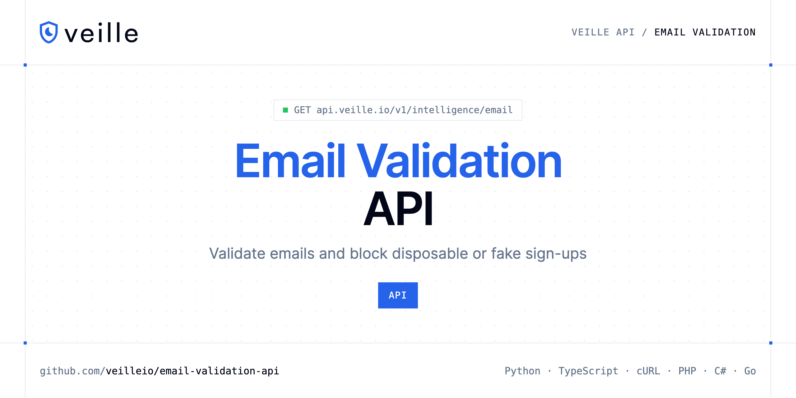

<p align="center">
  <a href="https://www.veille.io"></a>
</p>

# Email Validation API

[](https://discord.gg/CFj3ph8aHU) [](https://app.veille.io/register) [](https://app.veille.io/openapi) [](LICENSE)

The **Veille Email Validation API** checks an email address in real time so you can block invalid, disposable and risky sign-ups.

- **Email Validation API** — Validate any email address in a single call.

Use it in sign-up forms, lead capture, CRM hygiene and newsletter lists.

| Endpoint | Request | Credits |
|---|---|---|
| [Email Validation API](#email-validation-api) | `GET /v1/intelligence/email` | 3 |

## Table of contents

- [How it works](#how-it-works)
- [Email Validation API](#email-validation-api)
- [Code examples in other languages](#code-examples-in-other-languages)
- [Use cases](#use-cases)
- [Why Veille?](#why-veille)
- [FAQ](#faq)
- [Related repositories](#related-repositories)
- [Support](#support)

## How it works

1. **Create a Veille account** and copy your API key from the [dashboard](https://app.veille.io/register).
2. **Call `https://api.veille.io`** with the header `x-api-key: YOUR_API_KEY`.
3. **Use the result** in your app — no infrastructure to run.

```bash
export VEILLE_API_KEY="your-api-key"
pip install requests        # Python
# TypeScript: Node.js 18+ (native fetch), run with `npx tsx file.ts`
```

## Email Validation API

Validate any email address in a single call. Detects disposable and temporary inboxes, identifies role accounts, public webmail, relay services, and returns a 0-100 risk score. For deep deliverability verification (SMTP check, catch-all detection), use the Email Qualification endpoint.

`GET https://api.veille.io/v1/intelligence/email` · **3 credits per request** · [API reference](https://app.veille.io/openapi)

### Request parameters

| Parameter | In | Type | Required | Description |
|---|---|---|---|---|
| `query` | query | string | ✅ | The email address to validate (e.g. `john@example.com`). Automatically normalized to lowercase. |

### Python example

```python
import os

import requests

API_KEY = os.environ["VEILLE_API_KEY"]
HEADERS = {"x-api-key": API_KEY}

response = requests.get(
    "https://api.veille.io/v1/intelligence/email",
    headers=HEADERS,
    params={
        "query": "jane.doe@example.com",
    },
    timeout=120,
)
response.raise_for_status()

data = response.json()
print(data)
```

### TypeScript example

```typescript
type EmailValidationApi = {
  dns?: {
    mx?: boolean;
    spf?: string;
    dmarc?: unknown;
    spf_valid?: boolean;
    mx_records?: {
      hostname?: string;
      priority?: number;
    }[];
    dmarc_valid?: boolean;
    mx_providers?: unknown[];
  };
  email?: string;
  domain?: string;
  is_alias?: boolean;
  education?: boolean;
  role_type?: unknown;
  disposable?: boolean;
  risk_score?: number;
  did_you_mean?: unknown;
  has_gravatar?: boolean;
  relay_domain?: boolean;
  role_account?: boolean;
  public_domain?: boolean;
  normalized_email?: string;
};

const headers = { "x-api-key": process.env.VEILLE_API_KEY!, "Content-Type": "application/json" };

const params = new URLSearchParams({
  "query": "jane.doe@example.com",
});

const response = await fetch(`https://api.veille.io/v1/intelligence/email?${params}`, { headers });
if (!response.ok) throw new Error(`HTTP ${response.status}: ${await response.text()}`);

const data = (await response.json()) as EmailValidationApi;
console.log(data);
```

### Output example

Example response from the API reference, abridged.

```json
{
  "dns": {
    "mx": true,
    "spf": "v=spf1 include:_spf.tempmail.org ~all",
    "dmarc": null,
    "spf_valid": true,
    "mx_records": [
      {
        "hostname": "mx1.tempmail.org",
        "priority": 10
      }
    ],
    "dmarc_valid": false,
    "mx_providers": []
  },
  "email": "example",
  "domain": "tempmail.org",
  "is_alias": false,
  "education": false,
  "role_type": null,
  "disposable": true,
  "risk_score": 72,
  "did_you_mean": null,
  "has_gravatar": false,
  "relay_domain": false,
  "role_account": false,
  "public_domain": false,
  "normalized_email": "user@tempmail.org"
}
```

### Response fields

| Field | Type | Description |
|---|---|---|
| `dns` | object |  |
| `dns.mx` | boolean |  |
| `dns.spf` | string |  |
| `dns.dmarc` | object |  |
| `dns.spf_valid` | boolean |  |
| `dns.mx_records[]` | object[] |  |
| `dns.dmarc_valid` | boolean |  |
| `dns.mx_providers` | any[] |  |
| `email` | string |  |
| `domain` | string |  |
| `is_alias` | boolean |  |
| `education` | boolean |  |
| `role_type` | object |  |
| `disposable` | boolean |  |
| `risk_score` | integer |  |
| `did_you_mean` | object |  |
| `has_gravatar` | boolean |  |
| `relay_domain` | boolean |  |
| `role_account` | boolean |  |
| `public_domain` | boolean |  |
| `normalized_email` | string |  |

## Code examples in other languages

Ready-to-run examples live in [`examples/`](examples); each reads your key from `VEILLE_API_KEY`.

| Language | `intelligence-email` |
|---|---|
| cURL (Bash) | [intelligence_email.sh](examples/curl/intelligence_email.sh) |
| PHP | [intelligence_email.php](examples/php/intelligence_email.php) |
| C# | [IntelligenceEmail.cs](examples/csharp/IntelligenceEmail.cs) |
| Go | [intelligence_email.go](examples/go/intelligence_email.go) |
| Java | [IntelligenceEmailExample.java](examples/java/IntelligenceEmailExample.java) |
| Ruby | [intelligence_email.rb](examples/ruby/intelligence_email.rb) |
| Node.js | [intelligence_email.mjs](examples/nodejs/intelligence_email.mjs) |

## Use cases

- **Sign-up protection** — Reject fake and disposable addresses at registration.
- **List hygiene** — Clean CRM and newsletter lists before sending.

## Why Veille?

- **Stop fake sign-ups** — validate emails and domains before creating accounts.
- **Block abuse** — check IP reputation to stop bots and automated attacks.
- **Clean billing data** — validate VAT numbers and IBANs, get exchange rates.
- **Fast** — designed to run inline in sign-up and checkout flows.
- **Copy-paste examples** — Python and TypeScript in each README, 7 more languages in `examples/`.

## FAQ

### How do I authenticate?

Create an account on [Veille](https://app.veille.io/register), copy your API key and send it in the `x-api-key` header of every request to `https://api.veille.io`.

### How much does a request cost?

Credits per call: `/v1/intelligence/email` **3**. See [Veille pricing](https://www.veille.io/pricing).

### Which languages are supported?

Any language that can make an HTTP request. This README shows Python and TypeScript; the [`examples/`](examples) folder contains cURL, PHP, C#, Go, Java, Ruby and Node.js.

## Related repositories

- [Email Qualification API](https://github.com/veilleio/email-qualification-api)
- [Domain Validation API](https://github.com/veilleio/domain-validation-api)
- [IP Reputation API](https://github.com/veilleio/ip-reputation-api)
- [VAT Validation API](https://github.com/veilleio/vat-validation-api)
- [IBAN Validation API](https://github.com/veilleio/iban-validation-api)
- [Exchange Rates API](https://github.com/veilleio/exchange-rates-api)
- [All Veille repositories](https://github.com/veilleio)

## Support

- 💬 Join the [Discord](https://discord.gg/CFj3ph8aHU) to ask questions and share what you build.
- 📚 Read the [API reference](https://app.veille.io/openapi).
- 🔑 [Get your API key](https://app.veille.io/register).

---

<p align="center">
  <a href="https://www.veille.io">
    <picture>
      <source media="(prefers-color-scheme: dark)" srcset="images/logo-dark.svg">
      
    </picture>
  </a>
  <br>
  <sub>Built by <a href="https://www.veille.io">Veille</a>. Examples are released under the MIT license.</sub>
</p>
